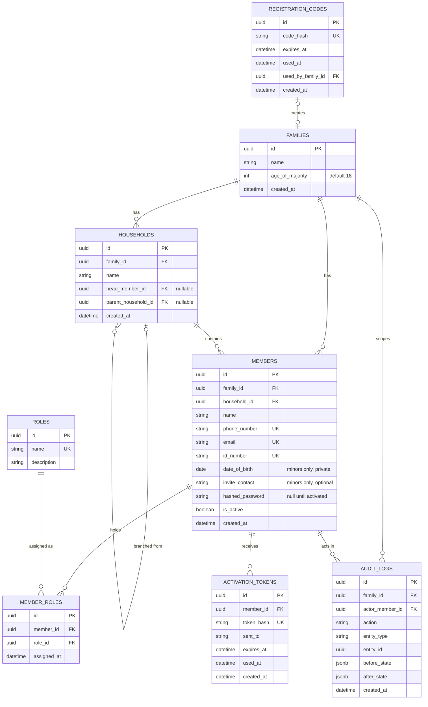
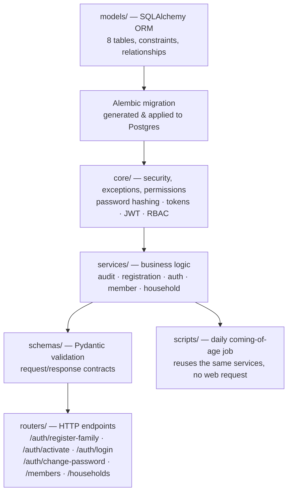
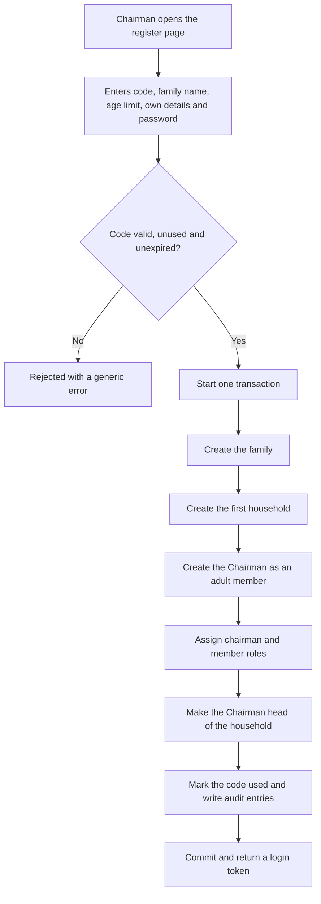
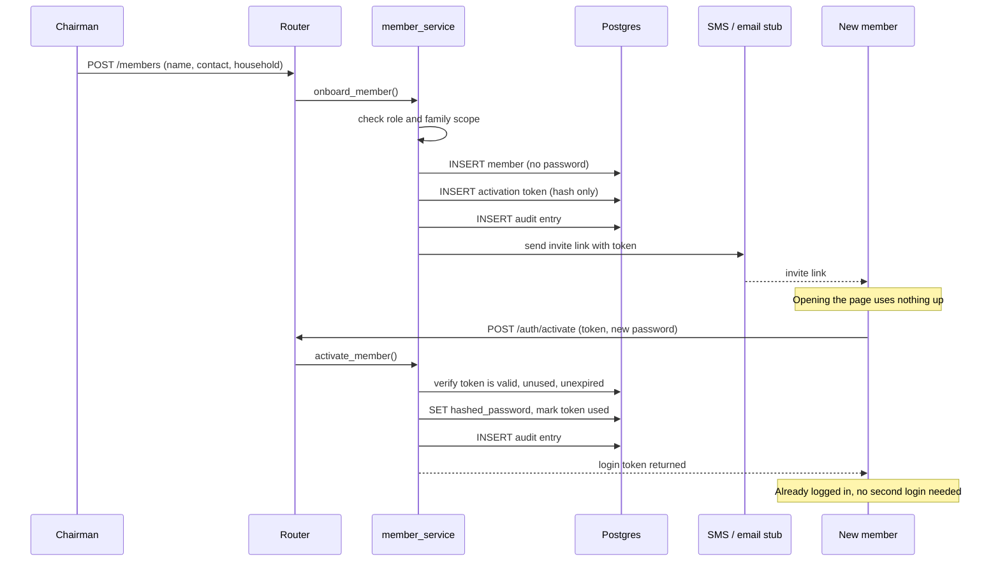
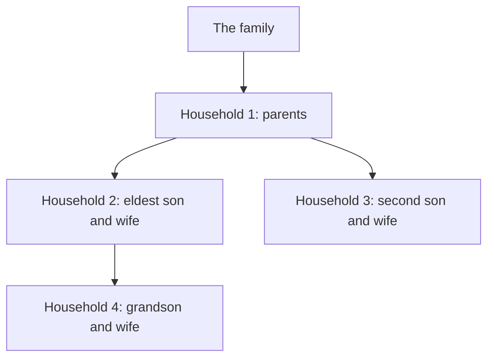
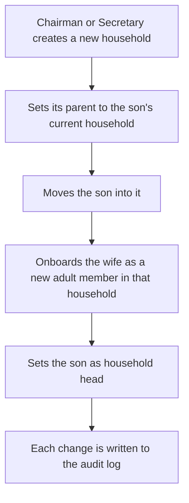
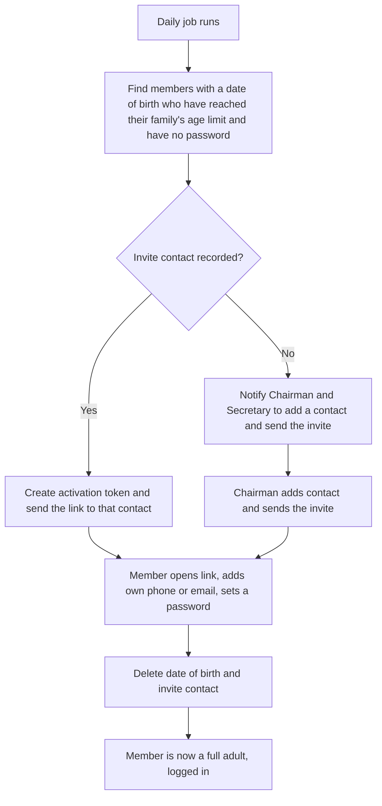
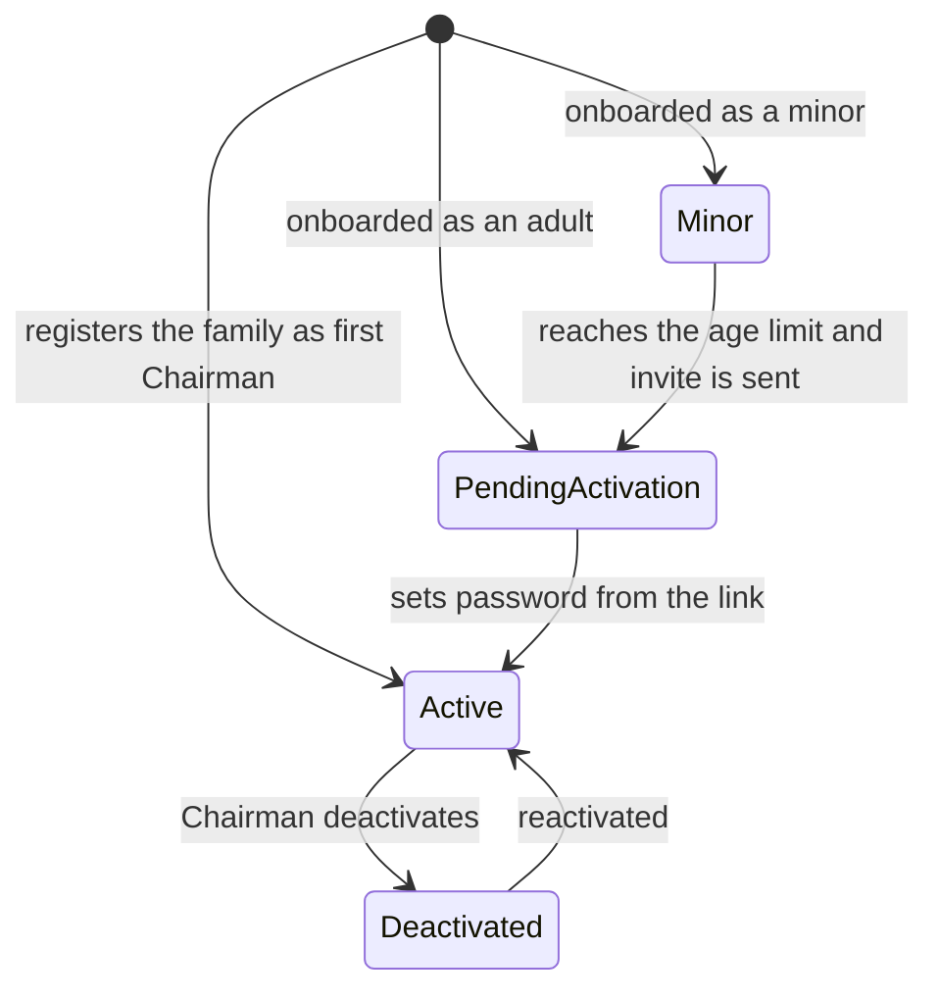
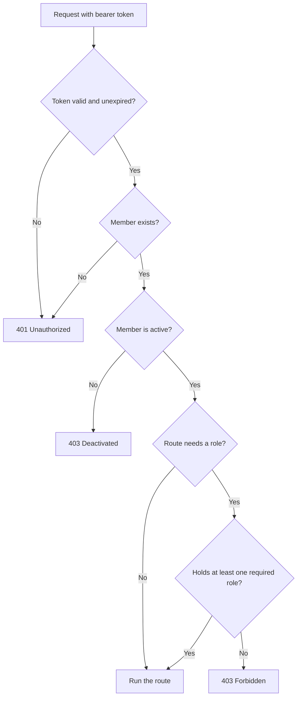

# Feature: Authentication — Entity-Relationship Diagram & Build Notes

`feature/auth` covers identity, family registration, household structure, invite-based onboarding, login, roles, privacy of personal data, and the audit-log foundation every later branch builds on.

## ==Introduction==

Every feature in this system — campaigns, pledges, payments, meetings, reports — depends on one question being answered first: who is doing this, and are they allowed to? feature/auth exists to answer that question properly, once, in a way every later branch can simply rely on rather than re-solving.

The system is built for many families, and each one is its own private organisation. A family is created by one person, its Chairman, and only if they hold a registration code issued by the platform. After that, membership is never self-service. A member does not sign themselves up. The Chairman or Secretary decides who is in, places them in a household, and the system reflects that decision, the same way it would be settled in a real family meeting.

The feature covers six things, each building on the one before it: the family as the root of its own data, the households inside it, the people who belong to those households, the roles those people can hold, the credentials that let them prove who they are, and an immutable record of everything that happens along the way. Nothing in this feature is throwaway scaffolding. Every table, every constraint, and every security decision here is the floor the other feature branches stand on.

## ==The Flow — from registration to active member==

It starts with a registration code. The platform administrator generates a one-time code and hands it to the person who will be a family's Chairman. That code is stored hashed, can be used once, and expires. Without it, nobody can create a family, which keeps the pilot free of spam and lets us decide who joins.

The future Chairman opens the register page and submits the code, a family name, the family's age limit for minors (18 unless they choose otherwise), their own details, and a password of their own choosing. Everything that follows happens in a single database transaction: the family is created, its first household is created, the Chairman is created as an adult member in that household, the `chairman` and `member` roles are assigned, the Chairman is made head of the household, and the code is marked as used. If any step fails, nothing is saved, so there can never be a family without a Chairman. Because the Chairman chose their own password here, they are logged in immediately, with no temporary credential at all.

From that point on, onboarding is entirely the Chairman's (or Secretary's) action. They give a new member's name, ID number, a phone number or an email so there is somewhere to deliver the invite, and the household the member belongs to. Nothing in that request says which family the member joins. That is never something the caller gets to choose. It is taken from the Chairman's own session, so there is no way to onboard a member into a family that isn't yours.

The system creates the member with no password and generates an activation token, a random 32-byte secret. Only its hash is stored. The plain token exists just long enough to be placed inside an invite link and sent by SMS or email, today through a stub that prints to the console, written so that a real gateway can replace it without touching onboarding itself.

The member opens the link and lands on a page asking for a new password. Opening the page uses up nothing, because SMS and email scanners often open links on their own. Only submitting the new password consumes the token. The system checks that it exists, belongs to this member, has not been used, and has not passed its 48-hour expiry. If all of that holds, the password is set, the token is marked used, and the member receives a login token in the same response. They are inside the app straight away, with the roles the Chairman assigned. The link only ever went to the member's own phone or email, so opening it already proves who they are, and a second login would add friction without adding safety.

Children are handled differently. A minor is onboarded as a minor, and the only extra detail required is their date of birth, which must put them under the family's age limit. Adults are never asked for a date of birth. A minor gets no account and no invite. The Chairman may record an optional invite contact, a parent's or guardian's phone or email, to be used later. A daily job watches for minors who have reached their family's age limit. If an invite contact exists, the activation link is sent there automatically. If it does not, the Chairman and Secretary are notified to add a contact and send the invite themselves. When the new adult activates, they enter their own phone or email, set a password, and the system deletes their date of birth and the invite contact. From then on, it holds no birth date for them at all.

Households follow the way families actually grow. A minor lives in their guardian's household. An adult child stays in their parents' household until they create their own. When a son marries, the Chairman or Secretary creates a new household for him and his wife, links it to the household it branched from, moves him in, onboards his wife as a new member, and names him head. It is still one family, and the branches can be traced for as long as the system exists. Contributions belong to individual members, not households, so moving house never moves anyone's financial history.

Finally, every step along that path, from the family's registration to the invite, the activation, every login, every household change and every date-of-birth lookup, leaves a permanent, unchangeable trace: who did it, what changed, and when. It isn't added afterwards. It is part of the same action, inside the same transaction, from the very first branch of this project onward.

## What's inside feature/auth

- **Eight database tables**

    Family, Household, Member, Role, MemberRole, ActivationToken, RegistrationCode, AuditLog — with foreign keys, unique constraints, and check constraints enforcing the rules above at the database level, not just trusted to application code.

- **Registration codes**

    One-time, expiring, stored hashed. They control who may create a family, and are the single gate that can later be swapped for phone or email verification.

- **Households with lineage**

    Every member belongs to exactly one household, and a household can record the household it branched from, so the family tree of branches is preserved.

- **Per-family minor rules**

    Each family sets its own age limit. Minor status is computed from date of birth and that limit, never stored, so it can never go stale.

- **Invite-based onboarding with automatic login**

    One-time activation links with hashed, single-use, expiring tokens. The member sets their own password and is logged in at once.

- **Automatic coming-of-age**

    A daily job turns minors into invited adults when they reach their family's limit, with the Chairman as the fallback when no contact exists.

- **Private date of birth**

    Stored only for minors, deleted at activation, visible to the member themselves, and available to the Chairman or Secretary only through a lookup that requires a stated reason and is audited.

- **Password security**

    bcrypt hashing for every password; cryptographically secure random generation for every token.

- **Session handling**

    JWT-based access tokens, signed with a secret kept out of version control.

- **A universal active-account gate**

    Checked in exactly one place, so a deactivated member is blocked from everything the instant that happens, with no risk of a forgotten endpoint that never learned to check it.

- **Role-based access control**

    Evaluated as the union of a member's roles, since one person can legitimately hold several at once.

- **Family isolation**

    Every query is scoped by the current member's `family_id`, so one family can never read another's data.

- **A clean separation of layers**

    Database models, security primitives, business logic, request validation, and HTTP endpoints each live in their own place, so the same logic could be reused outside a web request, such as the daily job, without changes.

- **An audit trail from the first commit**

    Not retrofitted later, but built in from the very first feature, so every later branch inherits the same discipline automatically.

## Entity-Relationship Diagram

**Eight entities, and the deliberate design choices worth highlighting:**

- **`MEMBER_ROLES` is a junction table**, not a single `role_id` column on
  `MEMBERS` — because role assignment is many-to-many (a Chairman can
  also be a contributing Member). A single foreign key can only ever
  point at one role; the junction table is what lets a member hold
  several roles at once.
- **Minors are `MEMBERS` rows too**, not a separate table. They are
  distinguished by a stored `date_of_birth`, with `hashed_password` left
  `NULL`. This keeps every other relationship that points at a member
  (future Pledge, Payment, Attendance tables) working unchanged for
  minors, with no parallel structures needed.
- **There is no `is_minor` column.** Whether someone is a minor is
  computed from `date_of_birth` and their family's `age_of_majority`. A
  stored flag would go stale on the child's birthday.
- **`date_of_birth` exists only while it is needed.** Adults never
  provide one, and a minor's is deleted when they activate their account.
- **`hashed_password` is nullable**, where `NULL` means "not activated
  yet". The database rule is: if a member has a password, they must
  have a phone number or an email.
- **`HOUSEHOLDS.parent_household_id` points back at the same table.**
  A new household records the one it branched from, so the family tree
  is just a column, with no extra table.
- **Tokens and codes are stored as hashes.** A leaked database can't be
  used to activate accounts or register families.
- **`MEMBERS.household_id` is required.** Everyone belongs to exactly one
  household, so nobody is left floating.

## How it was built — layered, bottom to top

Each layer only depends on the one below it — `routers` knows about
`schemas` and `services`, but `services` never imports FastAPI at all.
That separation is what lets the same `member_service.onboard_member()`
function be called from a web request today, and from the daily job or
a CLI script, with zero changes.

## The registration flow

## The onboarding → activation flow

## Households and branches

Households are managed only by the Chairman and Secretary. A minor joins their guardian's household, and an adult child stays in their parents' household until they create their own.

When a son marries:

Rules enforced by the service layer:

- A household head must be an adult member of that household.
- If the head moves or is deactivated, a new head must be chosen.
- A household cannot be its own parent.
- Contributions belong to members, so past payments and pledges stay on a member's record when they move.
- One person belongs to one family. A spouse already registered in another family must leave it before being onboarded here.

## Minors and coming of age

- Until the member activates, notifications keep going to their guardian.
- Raising a family's age limit keeps its minors as minors for longer. It never turns existing adults back into minors.
- A member who computes as a minor is refused at login, whatever their record says.

### Member lifecycle

## Date of birth privacy

| Who | Can see a date of birth? |
|---|---|
| The member themselves | Yes, on their own profile |
| Chairman or Secretary | Only through a lookup that requires a reason |
| Everyone else | Never. Lists show only "adult" or "minor" |

- Each lookup writes an audit entry recording who looked, at whom, and why. The date itself is not copied into the log.
- A date of birth never appears in audit `before_state` or `after_state`.
- It cannot be in the future.
- It is left out of every response schema except the member's own profile.

## How every request is checked

Every query after that is filtered by the current member's `family_id`, and every write is saved in the same transaction as its audit entry.

## Security measures built into this feature

- **Passwords are hashed with bcrypt**, never stored in plain text.
- **Registration codes and activation tokens are stored hashed**, are
  single-use, and expire, so a leaked row or a stolen link is of little use.
- **The activation token travels in the URL fragment**, which browsers
  don't send to servers or in referrer headers, so it stays out of logs.
- **Opening an invite link consumes nothing.** Only submitting the new
  password does, so link scanners can't burn a member's invite.
- **JWT-based sessions**, signed with a secret key kept out of version
  control (`.env`, gitignored).
- **`is_active` is checked in exactly one place** — the point a token
  resolves back to a member — so a deactivated member is blocked from
  *everything* the instant the Chairman flips the switch.
- **Role-based access control evaluates the union of a member's roles**,
  not a single assumed role, since one person can hold several.
- **Login errors are generic**, so they never reveal whether the
  identifier or the password was the wrong part.
- **Every query is scoped by `family_id`**, so families are isolated
  from one another.
- **Database-level `CHECK` constraints back up application-level
  validation** — e.g. a member with a password must have a phone or
  email, enforced by Postgres itself, not just trusted to the API layer.
- **Date of birth is private**, audited on every lookup, and deleted
  once a member is an adult.
- **Every registration, onboarding, activation, login, household change
  and date-of-birth lookup writes an immutable audit log entry**: actor,
  action, before/after state, timestamp. The allowed actions are
  `family.registered`, `member.onboarded`, `member.invite_sent`,
  `member.activated`, `member.login`, `member.password_changed`,
  `member.dob_viewed`, `member.household_changed`, `member.deactivated`
  and `household.created`.

## What's deliberately deferred

- Real SMS and email delivery — `send_sms()` is a stub that logs to
  console; swapping in a gateway later requires no change to the code.
- Token revocation and logout (a `jti` blacklist in Redis) and refresh
  tokens.
- Forgot-password, which can reuse the activation token mechanism.
- Rate limiting on login and activation.
- Phone or email verification, to replace registration codes when
  registration opens to the public.
- Bulk onboarding.
- A handover action to pass the Chairman role on.
- A "member leaves the family" action (deactivate, never delete).
- Friendly messages for database integrity errors.