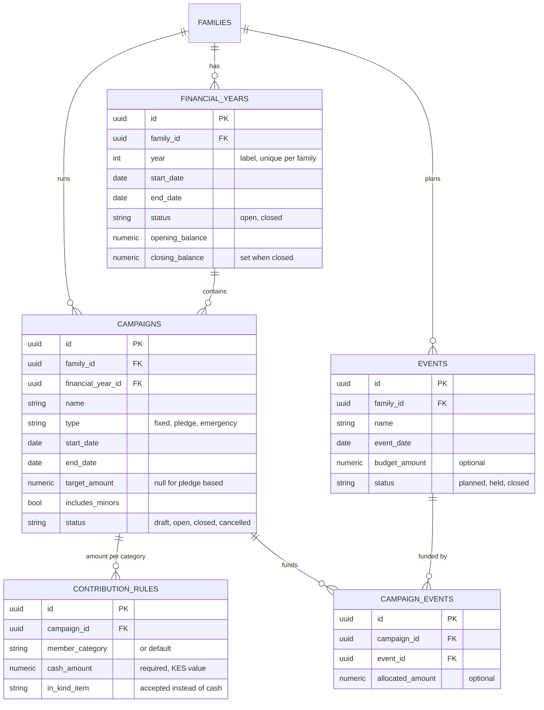
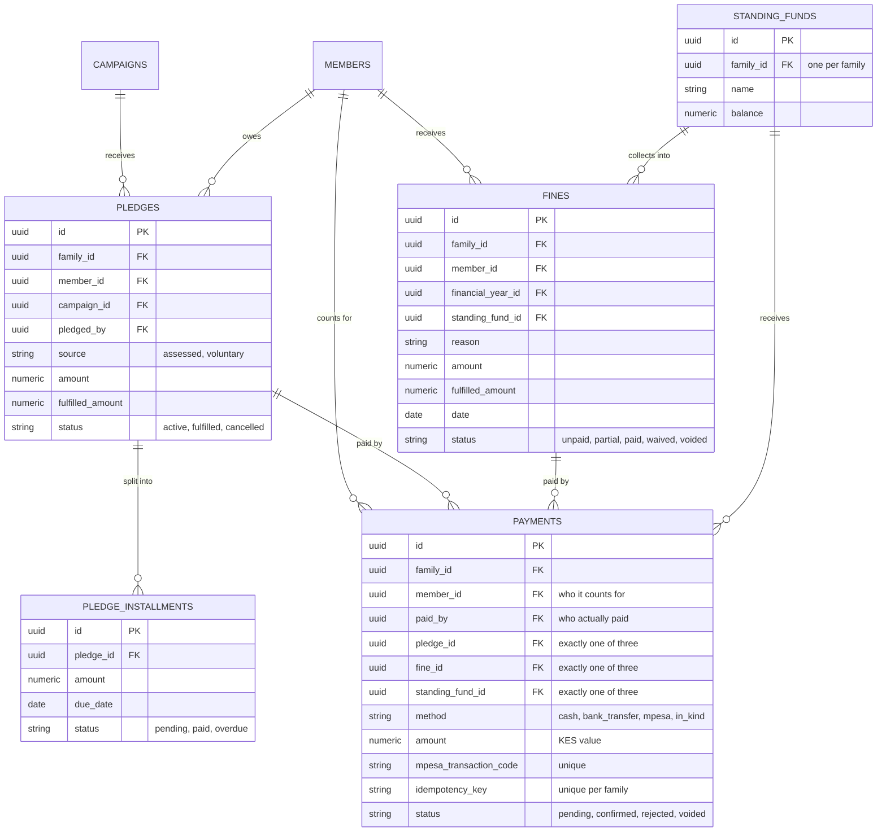
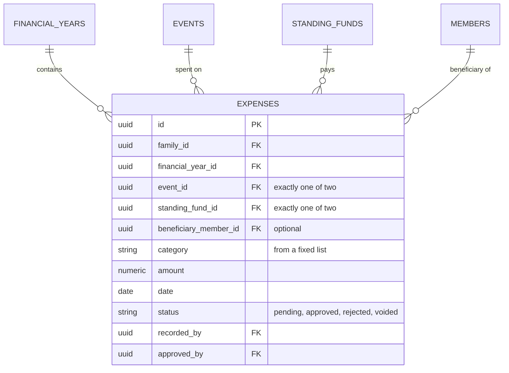
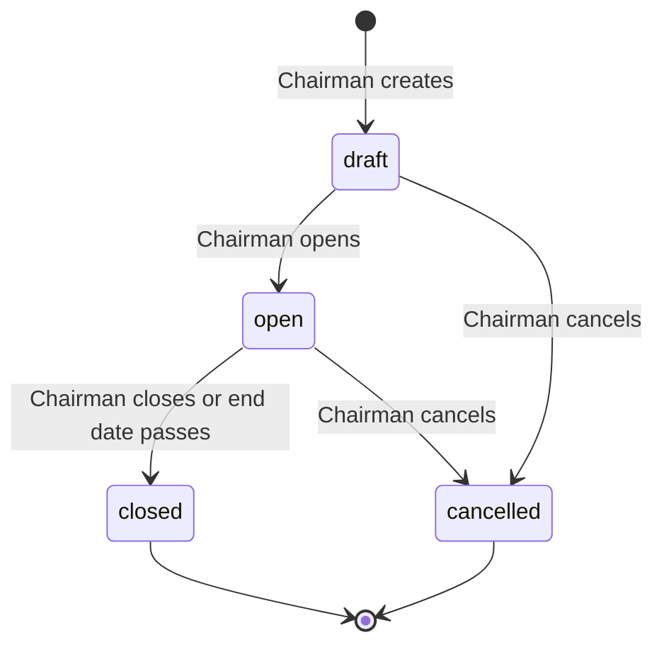
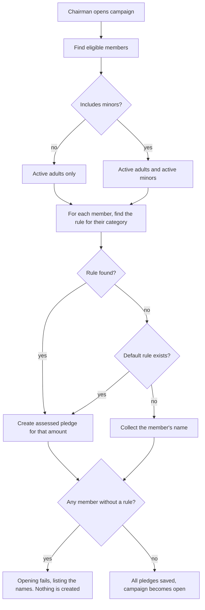
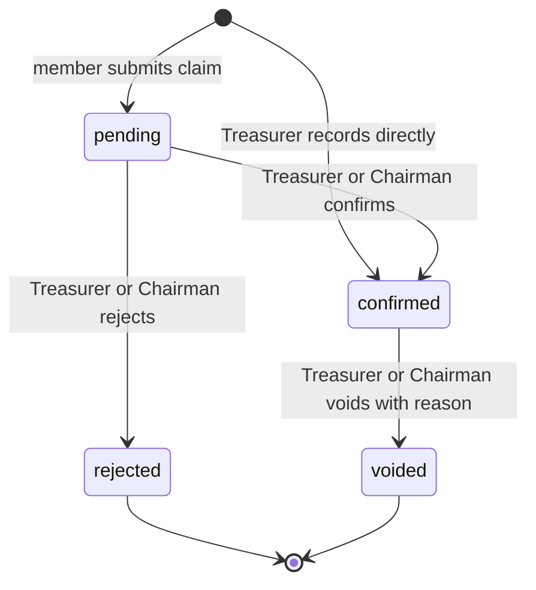
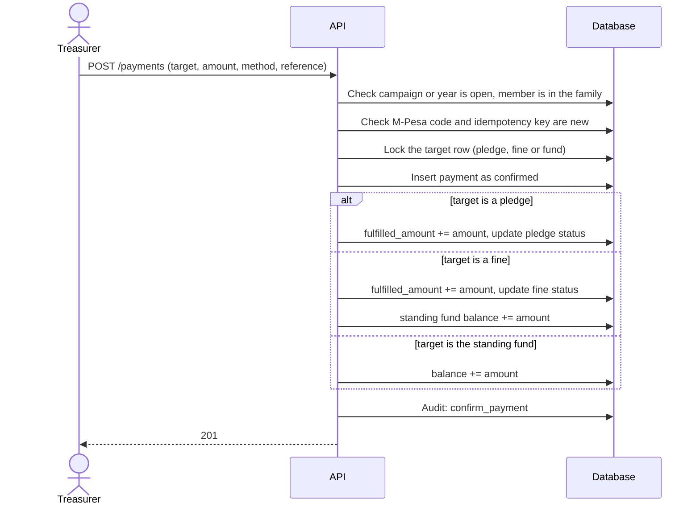
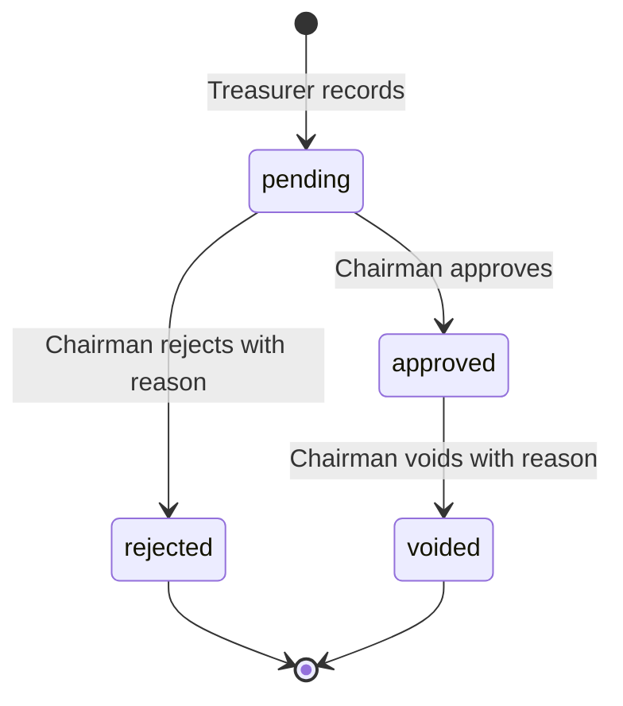

# Feature: Contributions, Payments, Fines, Expenses and Reporting

## 1. Overview

This is the core of the system: how a family raises money, how members pay, how money is spent, and how the year is reported.

**What it delivers**

- Campaigns of four kinds: fixed, pledge-based, emergency, and the always-open welfare fund
- Automatic assessment of every eligible member when a fixed campaign opens
- Pledges with optional installments
- Payments by cash, bank transfer, M-Pesa and in kind, with duplicate protection
- Fines, collected through the same payment table
- Expenses with Chairman approval, tied to events or the welfare fund
- Financial years with opening and closing balances
- A rule that money records are voided, never edited or deleted

**Three parts to the feature**

| Part | Tables | Question it answers |
|---|---|---|
| Money in | Campaign, ContributionRule, Pledge, PledgeInstallment, Fine, Payment | Who owes, who paid, how much |
| Money out | Expense | What was spent, on what, approved by whom |
| What it is for | Event, CampaignEvent | Which occasion the money serves |
| Containers | StandingFund, FinancialYear | The welfare pot and the reporting period |

---

## 2. Design rules

1. **Every money movement is a row, and rows are never edited or deleted.** A mistake is voided with a reason, and the void is audited.
2. **Balances come from the rows.** Where a stored total exists (`Pledge.fulfilled_amount`, `Fine.fulfilled_amount`, `StandingFund.balance`), exactly one service function changes it, inside the same transaction, after locking the row (`with_for_update`). A reconcile script recomputes the totals from the payments and reports any difference.
3. **Every row carries `family_id`**, and every query is scoped to the logged-in officer's family. Another family's record is reported as "not found".
4. **Money is `Numeric(12,2)` in KES.** Never floats. Every amount has a `CHECK (amount > 0)`.
5. **Contributions are per member.** A payment counts for one member, and `paid_by` records who actually paid (for example a parent paying for a child).
6. **Privacy.** An ordinary member sees only their own pledges, payments and fines. Everyone sees family totals, never another member's individual record. Officers see all records in their family.
7. **A closed period is closed.** A closed campaign accepts no new pledges or payments. A closed financial year accepts no new records at all.
8. **Statuses are plain strings validated at the schema layer**, so a new status does not need a schema migration.

---

## 3. Entity relationship diagram

The model is shown in three smaller diagrams, one for each part of the feature. To keep each one readable, the diagrams show the key columns only. The audit columns (`recorded_by`, `confirmed_by`, `confirmed_at`, `voided_by`, `voided_at`, `void_reason`, `created_at`) are listed in section 4.

### 3.1 Planning: years, campaigns, rules and events

### 3.2 Money in: pledges, payments, fines and the welfare fund

### 3.3 Money out: expenses

---

## 4. Changes to the existing models

These are the differences between the models in the repository now and the design above. The migration is written by hand, because Alembic does not detect CHECK constraint changes or data backfills.

**Campaign**
- Add `name`, `created_by`.
- Status becomes `draft`, `open`, `closed`, `cancelled`, default `draft`.
- Remove the `standing` type. The welfare fund is the `StandingFund` table, not a campaign.

**ContributionRule**
- `cash_amount` becomes required and is always the KES value. `in_kind_item` now means "this item is accepted instead of cash", so every pledge has a money amount.
- `UNIQUE(campaign_id, member_category)`.

**Pledge**
- Add `family_id`, `pledged_by`, `source`, `status`.
- `UNIQUE(member_id, campaign_id)`.
- `CHECK (amount > 0)` and `CHECK (fulfilled_amount >= 0)`.

**Payment**
- Add `family_id`, `fine_id`, `paid_by`, `recorded_by`, `confirmed_at`, `voided_by`, `voided_at`, `void_reason`.
- Status gains `voided`.
- `CHECK` that exactly one of `pledge_id`, `fine_id`, `standing_fund_id` is set.
- `CHECK (amount > 0)`.
- `idempotency_key` becomes unique per family, not across the platform.

**Fine**
- Add `family_id`, `financial_year_id`, `standing_fund_id`, `recorded_by`, `fulfilled_amount`, `status`, `created_at`.
- `CHECK (amount > 0)`.

**Expense**
- Add `status`, `approved_at`, `voided_by`, `voided_at`, `void_reason`.
- `CHECK` that exactly one of `event_id`, `standing_fund_id` is set.
- Category is validated against a fixed list at the schema layer.

**Event**
- Add `budget_amount`, `status`.

**CampaignEvent**
- Add `allocated_amount`, optional.

**FinancialYear**
- Add `start_date`, `end_date` and `status`. Each family sets its own year dates.
- `CHECK (end_date > start_date)`.
- `UNIQUE(family_id, year)`. `year` stays as the label of the year (for example 2026).
- A family's years may not overlap. The service enforces it when a year is created.
- Existing rows are backfilled in the migration as 1 January to 31 December of their `year`.

**StandingFund**
- `UNIQUE(family_id)`. One welfare fund per family, created the first time it is needed.

**Audit**
- New actions: `open_campaign`, `close_campaign`, `cancel_campaign`, `confirm_payment`, `reject_payment`, `void_payment`, `waive_fine`, `void_fine`, `approve_expense`, `reject_expense`, `void_expense`, `close_financial_year`.
- New entity types: `financial_year`, `campaign`, `pledge`, `payment`, `fine`, `expense`, `event`, `standing_fund`.
- The audit table's CHECK constraints are widened in the same migration.

Financial years carry their own start and end dates, because families run their year differently. A record's year is found from its date: a fine, expense or confirmed payment belongs to the year whose dates contain it.

---

## 5. Campaigns

### 5.1 Types

| Type | Who owes | How amounts are set |
|---|---|---|
| `fixed` | Every eligible member, assessed automatically | `ContributionRule` rows by member category |
| `pledge` | Whoever chooses to pledge | The member (or an officer on their behalf) names an amount |
| `emergency` | Same as `pledge`, but short-notice | Same as `pledge` |

The welfare fund is not a campaign. See section 9.

### 5.2 Lifecycle

- **Draft.** Rules can be added and edited. No pledges exist yet.
- **Open.** Rules are locked. For a `fixed` campaign, the system has created the member pledges. Pledges and payments are accepted.
- **Closed.** No new pledges or payments. Existing records stay.
- **Cancelled.** Only allowed if no confirmed payment exists. Otherwise the Chairman must close it and void the payments with reasons.

### 5.3 Opening a fixed campaign

- Opening is all or nothing. If any member has neither a rule for their category nor a `default` rule, the Chairman gets the full list of names and nothing is created.
- Amounts are a snapshot. Changing rules later has no effect on pledges already created, which is why rules lock when the campaign opens.
- A member onboarded after the campaign opened gets no automatic pledge. The Chairman can assess them with `POST /campaigns/{id}/pledges`.
- A minor's pledge has `pledged_by` set to their guardian, if they have one.

### 5.4 Pledge-based and emergency campaigns

A member pledges once per campaign. The pledge can be raised later but not lowered below what is already paid. A member who cannot log in (including every minor) has their pledge recorded by an officer, with `pledged_by` set to the person who made the commitment.

---

## 6. Pledges and installments

- `fulfilled_amount` goes up when a payment is confirmed and down when it is voided.
- Status moves `active` to `fulfilled` when `fulfilled_amount >= amount`, and back to `active` if a void drops it below.
- A pledge can be split into installments. The installments must add up exactly to the pledge amount.
- Installments are not paid individually. Payments apply oldest-first: an installment counts as paid when the pledge's `fulfilled_amount` covers the total of that installment and all earlier ones.
- A daily job (`scripts/mark_overdue_installments.py`) marks as `overdue` any installment past its due date that is not yet covered. It is safe to run repeatedly.

---

## 7. Payments

### 7.1 Who records, who confirms

| Situation | Starting status | Confirmed by |
|---|---|---|
| Treasurer records cash, a bank transfer or an M-Pesa payment | `confirmed` straight away | Not needed. The Treasurer is the recorder and the confirmer |
| A member submits a claim that they paid (their M-Pesa code, say) | `pending` | Treasurer or Chairman |
| A claim is wrong | `rejected` | Treasurer or Chairman, with a reason |

### 7.2 Payment lifecycle

### 7.3 What happens when a payment becomes confirmed

All of this runs in one transaction, after locking the target row:

Voiding runs the same steps in reverse and writes `void_payment` with the reason.

### 7.4 Rules

- Exactly one target: a pledge, a fine or the standing fund. A database CHECK enforces it.
- The payment's amount is a KES amount. For an in-kind payment the Treasurer enters the KES value, and `item_description` records what was given (for example "one hen").
- A payment may not push a pledge or fine above its amount. An overpayment is rejected, and the Treasurer must record the surplus against the standing fund as a separate payment.
- The same M-Pesa transaction code or idempotency key can never create a second payment. A retry gets the original payment back.
- A payment cannot be recorded against a closed campaign, a cancelled pledge, or a closed financial year.

---

## 8. Fines

- Recorded by the Chairman or Secretary against a member, with a reason, an amount and a date. The fine belongs to the financial year of its date.
- Collected through the same `payments` table, with `fine_id` set.
- Fine money goes into the family's standing fund. Confirming a payment against a fine increases both `Fine.fulfilled_amount` and `StandingFund.balance`. Voiding reverses both.
- Status: `unpaid`, `partial`, `paid`, `waived`, `voided`.
  - **Waived** means the Chairman forgave a real fine. It requires a reason and is audited.
  - **Voided** means the fine was recorded by mistake. It requires a reason and is audited.
  - A fine with confirmed payments cannot be waived or voided until those payments are voided.
- Privacy: a member sees their own fines. Other members see only the family totals.

---

## 9. Standing fund (welfare fund)

- One per family, created the first time it is needed.
- Money in: payments aimed at it, and fine payments.
- Money out: approved expenses drawn on it.
- `balance` goes up on a confirmed payment, and down on an approved expense. Both are reversed by voids.
- **A payout that would take the balance below zero is blocked.** The approval fails with a clear message. The Treasurer corrects the amount or records the missing money first.

---

## 10. Events, event funding and expenses

### 10.1 Events

An event is what the money is for: a wedding, a funeral, an annual meeting. It has a date, an optional budget and a status (`planned`, `held`, `closed`).

### 10.2 Linking campaigns to events

A campaign can fund several events, and an event can be funded by several campaigns. `CampaignEvent` records the link and an optional `allocated_amount`.

- If the Chairman sets allocations, each event shows what it was allocated and what has been spent.
- If allocations are empty, the event shows the linked campaigns' totals without a split.
- The sum of a campaign's allocations may not exceed its target amount (when it has one).

### 10.3 Expenses

An expense is money out, with exactly one source: an event or the standing fund. If a cost spans both, the Treasurer records two expenses.

- Every expense needs the Chairman's approval. For now there is no threshold.
- The approver must be a different person from the recorder.
- A pending expense does not count in any balance. Approval is what makes it count.
- On approval of a standing-fund expense, the balance goes down. If that would take it below zero, the approval is blocked.
- `beneficiary_member_id`, when given, must belong to the same family.
- Category must come from a fixed list (for example transport, food, venue, bereavement support, printing, other), so reports group cleanly.

---

## 11. Financial years

- A financial year has a start date, an end date, an opening balance, a status and, once closed, a closing balance.
- The Chairman creates a year and sets its dates. Years of one family may not overlap.
- A campaign belongs to one year, and its start and end dates must fall inside that year.
- A fine or expense belongs to the year whose dates contain its date. If no open year contains the date, it is rejected.
- **Closing a year** is allowed only when every campaign in it is closed or cancelled, no payment is `pending`, and no expense is `pending`. If any remain, closing fails with a list.
- On closing, the system computes the closing balance (opening balance plus confirmed income minus approved expenses) and stores it.
- A new year's opening balance defaults to the closing balance of the latest closed year before it. The earlier year must be closed first.
- A closed year accepts no new records. A correction for a closed year is entered as a dated record in the current year.
- Closing writes `close_financial_year` to the audit log.

---

## 12. Roles and permissions

| Action | Chairman | Secretary | Treasurer | Member |
|---|---|---|---|---|
| Create financial year, close it | Yes | No | No | No |
| Create, open, close, cancel a campaign | Yes | No | No | No |
| Add and edit contribution rules (draft only) | Yes | No | No | No |
| Create events, link campaigns to events | Yes | Yes | No | No |
| View campaigns and totals | Yes | Yes | Yes | Totals only |
| Assess or record a pledge for someone | Yes | Yes | Yes | Own pledge only |
| Record a payment | Yes | No | Yes | Submit a claim for themselves |
| Confirm or reject a claim, void a payment | Yes | No | Yes | No |
| Record, waive or void a fine | Yes | Yes | No | No |
| Record an expense | No | No | Yes | No |
| Approve, reject or void an expense | Yes | No | No | No |
| View own pledges, payments, fines | Yes | Yes | Yes | Yes |
| View any member's records | Yes | Yes | Yes | No |

---

## 13. Endpoints

### Part 1: financial years, campaigns, rules, assessed pledges

| Method | Path | Who | Purpose |
|---|---|---|---|
| POST | `/financial-years` | Chairman | Create a year |
| GET | `/financial-years` | Chairman, Secretary, Treasurer | List years |
| POST | `/financial-years/{id}/close` | Chairman | Close a year |
| POST | `/campaigns` | Chairman | Create a draft campaign |
| GET | `/campaigns` | Officers | List, filter by year or status |
| GET | `/campaigns/{id}` | Officers | One campaign with totals |
| PUT | `/campaigns/{id}/rules` | Chairman | Set the rules (draft only) |
| POST | `/campaigns/{id}/open` | Chairman | Open, assessing members if fixed |
| POST | `/campaigns/{id}/close` | Chairman | Close |
| POST | `/campaigns/{id}/cancel` | Chairman | Cancel |
| POST | `/campaigns/{id}/pledges` | Chairman | Assess a late-joining member |

### Part 2: pledges and payments

| Method | Path | Who | Purpose |
|---|---|---|---|
| POST | `/campaigns/{id}/my-pledge` | Member | Make or raise my own pledge |
| POST | `/pledges` | Officers | Record a pledge for a member |
| GET | `/pledges` | Officers | List, filter by campaign or member |
| GET | `/pledges/me` | Member | My pledges |
| POST | `/pledges/{id}/installments` | Officers | Set the installment plan |
| POST | `/pledges/{id}/cancel` | Chairman | Cancel (only if nothing paid) |
| POST | `/payments` | Chairman, Treasurer | Record a confirmed payment |
| POST | `/payments/claims` | Member | Submit a payment claim |
| POST | `/payments/{id}/confirm` | Chairman, Treasurer | Confirm a claim |
| POST | `/payments/{id}/reject` | Chairman, Treasurer | Reject a claim, with reason |
| POST | `/payments/{id}/void` | Chairman, Treasurer | Void, with reason |
| GET | `/payments` | Officers | List, filter |
| GET | `/payments/me` | Member | My payments |

### Part 3: fines and the standing fund

| Method | Path | Who | Purpose |
|---|---|---|---|
| POST | `/fines` | Chairman, Secretary | Record a fine |
| GET | `/fines` | Officers | List |
| GET | `/fines/me` | Member | My fines |
| POST | `/fines/{id}/waive` | Chairman | Waive, with reason |
| POST | `/fines/{id}/void` | Chairman, Secretary | Void, with reason |
| GET | `/standing-fund` | Officers | Balance and recent movements |

### Part 4: events and expenses

| Method | Path | Who | Purpose |
|---|---|---|---|
| POST | `/events` | Chairman, Secretary | Create an event |
| GET | `/events` | Officers | List with budget, funding and spend |
| PUT | `/events/{id}/campaigns` | Chairman, Secretary | Link campaigns, with optional allocations |
| POST | `/expenses` | Treasurer | Record, pending |
| POST | `/expenses/{id}/approve` | Chairman | Approve |
| POST | `/expenses/{id}/reject` | Chairman | Reject, with reason |
| POST | `/expenses/{id}/void` | Chairman | Void, with reason |
| GET | `/expenses` | Officers | List, filter |

### Part 5: reports and jobs

| Method | Path or script | Purpose |
|---|---|---|
| GET | `/reports/campaigns/{id}` | Progress: target, pledged, paid, outstanding, who still owes |
| GET | `/reports/members/{id}/statement` | One member's pledges, fines and payments |
| GET | `/reports/me/statement` | My own statement |
| GET | `/reports/financial-years/{id}` | The annual report: income by source, expenses by category and event, opening and closing balance |
| script | `mark_overdue_installments.py` | Daily: mark overdue installments |
| script | `reconcile_balances.py` | Recompute stored totals from payments and report differences |

### Error mapping

| Situation | HTTP |
|---|---|
| Record not in the caller's family | 404 |
| Wrong role | 403 |
| Duplicate M-Pesa code or idempotency key | 409 (idempotent retry returns the original) |
| Closed campaign, closed year, overpayment, overdraft, member without a rule, approver same as recorder | 422 |

---

## 14. Audit trail

Every state change writes an audit entry with who did it, to which record, and the before and after status. Money amounts appear in the snapshot. Reasons are always recorded for voids, rejections, waivers and cancellations.

The audit service already refuses snapshots containing a password, token or date of birth. It stays that way.

---

## 15. Code layout

| Layer | Files |
|---|---|
| Models | `financial_year.py`, `campaign.py`, `contribution_rule.py`, `pledge.py`, `pledge_installment.py`, `payment.py`, `fine.py`, `standing_fund.py`, `event.py`, `campaign_event.py`, `expense.py` |
| Services | `financial_year_service.py`, `campaign_service.py`, `pledge_service.py`, `payment_service.py`, `fine_service.py`, `standing_fund_service.py`, `event_service.py`, `expense_service.py`, `report_service.py` |
| Schemas | One file per area, with a shared `money.py` for the amount type |
| Routers | One per area, mounted under the paths in section 13 |
| Scripts | `mark_overdue_installments.py`, `reconcile_balances.py` |

Services hold the rules and never commit. Routers are thin: check the role, call one service function, commit, return the response. `payment_service` is the only code that changes `fulfilled_amount` and `balance`.

---

## 16. Build order

1. **Part 1:** model changes and migration, financial years, campaigns, rules, assessed pledges.
2. **Part 2:** voluntary pledges, installments, payments (record, claim, confirm, reject, void), balance logic.
3. **Part 3:** fines and the standing fund.
4. **Part 4:** events, event funding, expenses with approval.
5. **Part 5:** reports and the two scripts.

Each part ends with a test walkthrough before the next one starts.

---

## 17. Assumptions and open items

- A confirmed payment into the welfare fund belongs to the year containing the date it was confirmed.
- A member who joins after a fixed campaign opens must be assessed by hand.
- Late fees and penalties on overdue pledges are not automatic. An officer records a fine.
- M-Pesa payments are entered by hand. An automatic M-Pesa callback is a separate later feature.
- Recurring campaigns (the same levy every month) are handled by installments for now. A scheduler that creates next month's campaign is not built.
- Households do not owe or pay as a unit. Contributions are per member.
- Spending approval has no amount threshold. Every expense needs the Chairman.
- Exports (PDF, Excel) of reports are not built yet.