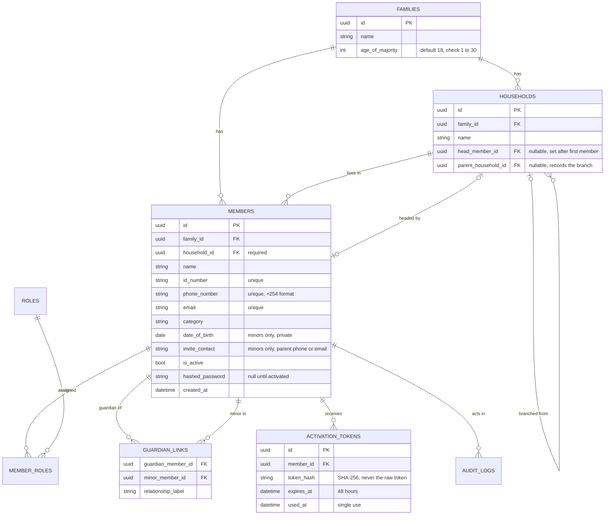
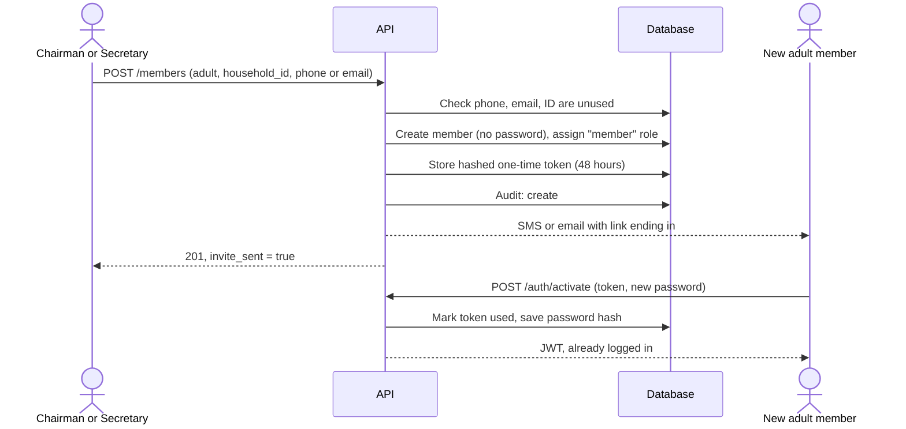
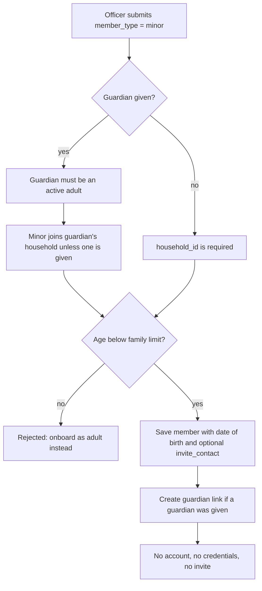
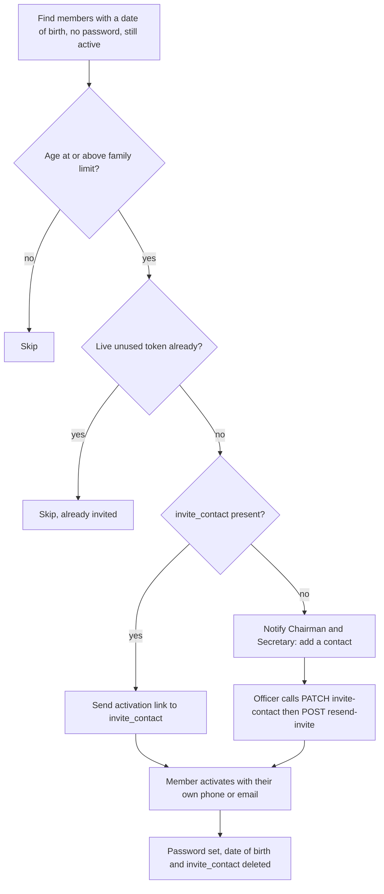
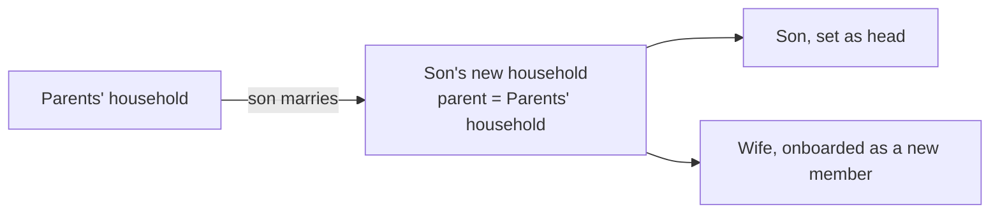

# Feature: Members, Households and Onboarding

## 1. Overview

This feature covers everything that happens after a family has been created: how members are added, how they are grouped into households, how minors become adult members, and how an officer can deactivate a member or look up a private date of birth.

**What it delivers**

- Onboarding of adults and minors by the Chairman or Secretary
- One-time activation links, so no temporary passwords exist anywhere
- Households (nuclear families) with branches recorded when a household splits off
- Automatic coming-of-age invitations, using a per-family age limit
- Deactivate and reactivate, never delete
- An audited, reason-required date-of-birth lookup

**Roles that matter here**

| Role | Can do |
|---|---|
| Chairman | Everything below, including deactivating another chairman |
| Secretary | Onboard, manage households, invites, deactivate, DOB lookup |
| Treasurer | View the member directory and households only |
| Member | View own record only (`GET /members/me`) |

---

## 2. Design rules

1. **One person, one family.** Phone, email and ID number are unique across the whole platform.
2. **The family always comes from the logged-in officer**, never from the request body. A member of another family is reported as "not found", so nothing leaks across families.
3. **Every member belongs to exactly one household.** The household is required and must exist before the member is created.
4. **Contributions are per member**, not per household. A member's history moves with them when they change household.
5. **The age limit is per family** (`families.age_of_majority`, default 18, range 1 to 30). It is typed in by the Chairman at registration. It is not in `.env`.
6. **Minor status is computed**, never stored. A member is a minor when they have a date of birth and their age is below their family's limit.
7. **Date of birth is kept only for minors.** Adults give none. It is deleted when the minor activates their account.
8. **Date of birth is private.** It never appears in a normal response or in an audit snapshot. The only way to see it is the audited lookup.
9. **Minors have no account and no credentials.** They join their guardian's household by default.
10. **Members are deactivated, never deleted**, so financial history stays intact.

---

## 3. Entity relationship diagram

**Database checks on `members`**

| Constraint | Rule |
|---|---|
| `check_password_needs_contact` | A password can only exist if there is a phone or an email |
| `check_invite_contact_minors_only` | `invite_contact` is only allowed when `date_of_birth` is set |
| `check_phone_format` | `^\+254[17][0-9]{8}$` |
| `check_id_number_format` | Exactly 8 digits |

`households.head_member_id` and `members.household_id` point at each other. The foreign key from households to members is declared with `use_alter`, and the code creates the household first and sets its head afterwards.

---

## 4. Flows

### 4.1 Onboarding an adult

The token sits in the URL fragment (`#token=`), so it never reaches server logs. Opening the page consumes nothing. Only the POST consumes the token.

### 4.2 Onboarding a minor

A minor has no phone or email of their own. If a parent or guardian contact is known, it is stored as `invite_contact`.

### 4.3 Coming of age (daily job)

`python -m scripts.process_coming_of_age`, scheduled once a day.

The job is safe to run repeatedly. A member who already has a live invite is skipped, and an officer is never sent the same notification twice.

### 4.4 Households and branches

- An adult child stays in the parents' household until a new one is created.
- When a son marries, an officer creates a household with `parent_household_id` set to the old one, moves the son in, onboards the wife into it, and sets the head.
- The head must be an active adult who lives in that household.
- If the head is moved out, the old household is left without a head until a new one is chosen.
- The wife joins this family. She must not belong to another family on the platform.

### 4.5 Deactivation

| Check | Result if it fails |
|---|---|
| Target is in the officer's family | 404 |
| Target is not the officer themselves | 422 |
| Target is not already deactivated | 422 |
| Target is a chairman and the officer is not | 403 |
| Target is the last active chairman | 422 |

A deactivated member is blocked from every endpoint at once, because `is_active` is checked on every authenticated request. Reactivation reverses it.

### 4.6 Date-of-birth lookup

An officer sends `POST /members/{id}/date-of-birth-lookup` with a `reason` of at least 10 characters. The server writes an audit entry (`view_date_of_birth`) containing who looked, at whom, when, and the reason. The date itself is never written to the log. For an adult the response has `date_of_birth: null`.

It is a POST, not a GET, because it writes an audit entry and the reason should not travel in the URL.

---

## 5. Endpoints

### Members

| Method | Path | Who | Purpose | Main failures |
|---|---|---|---|---|
| GET | `/members/me` | Any logged-in member | Own record and roles | 401 |
| POST | `/members` | Chairman, Secretary | Onboard an adult or minor | 409 duplicate, 404 household, 422 rules |
| GET | `/members` | Chairman, Secretary, Treasurer | Directory, optional `?household_id=` | 403 |
| GET | `/members/{id}` | Chairman, Secretary, Treasurer | One member | 404 |
| POST | `/members/{id}/resend-invite` | Chairman, Secretary | New activation link, cancels older ones | 422 minor or already activated |
| PATCH | `/members/{id}/invite-contact` | Chairman, Secretary | Set a minor's parent or guardian contact | 422 not a minor |
| POST | `/members/{id}/deactivate` | Chairman, Secretary | Block a member | 403, 422 |
| POST | `/members/{id}/reactivate` | Chairman, Secretary | Unblock a member | 422 already active |
| POST | `/members/{id}/date-of-birth-lookup` | Chairman, Secretary | Audited date-of-birth lookup | 422 short reason |

### Households

| Method | Path | Who | Purpose | Main failures |
|---|---|---|---|---|
| POST | `/households` | Chairman, Secretary | Create, optional `parent_household_id` | 404 parent |
| GET | `/households` | Chairman, Secretary, Treasurer | List with member counts | 403 |
| GET | `/households/{id}` | Chairman, Secretary, Treasurer | One household | 404 |
| PATCH | `/households/{id}/head` | Chairman, Secretary | Set the head | 422 not a member, minor or inactive |
| POST | `/households/{id}/members` | Chairman, Secretary | Move a member in | 422 already there |

### Error mapping

| Domain error | HTTP |
|---|---|
| NotFoundError | 404 |
| PermissionDeniedError | 403 |
| DuplicateMemberError | 409 |
| BusinessRuleError | 422 |
| ContactRequiredError | 400 |

---

## 6. Audit trail

| Action | Written when |
|---|---|
| `create` (member) | A member is onboarded |
| `create` (household) | A household is created |
| `update` (household) | The head is changed |
| `update` (member) | Invite contact set, or member reactivated |
| `change_household` | A member is moved |
| `deactivate_member` | A member is deactivated |
| `send_invite` | An activation link is issued |
| `activate_member` | A member activates |
| `view_date_of_birth` | An officer looks up a date of birth |

The audit service refuses any snapshot containing `hashed_password`, `date_of_birth`, `password` or `token`.

---

## 7. Code layout

| Layer | Files |
|---|---|
| Models | `member.py`, `household.py`, `family.py`, `guardian_link.py`, `activation_token.py` |
| Core | `age.py`, `permissions.py`, `normalizers.py`, `exceptions.py` |
| Services | `member_service.py`, `household_service.py`, `auth_service.py`, `audit_service.py` |
| Schemas | `members.py`, `households.py`, `common.py` |
| Routers | `members.py`, `households.py` |
| Scripts | `process_coming_of_age.py` |

Services hold the rules and never commit. Routers are thin: check the role, call one service function, commit, return the response.

---

## 8. Assumptions and open items

- When a minor activates, the guardian link stays as a record but stops routing notifications.
- A spouse joining from another family must leave that family first. There is no "leave family" action yet.
- SMS and email are console stubs. A real gateway comes later.
- Bulk onboarding (many members at once) is not built.
- Chairman handover is not built. The last active chairman cannot be deactivated, which prevents a family being locked out.
- Login and activation have no rate limiting yet.
- Changing a password does not revoke tokens already issued.